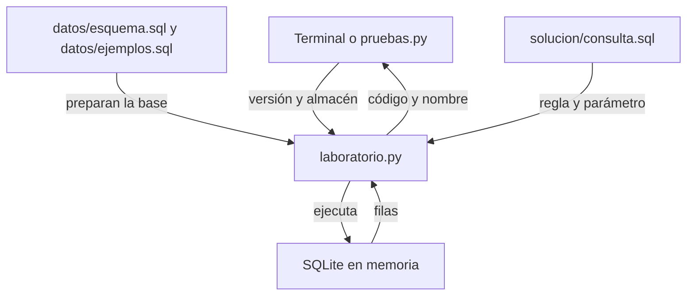

# Arquitectura del laboratorio

Este mapa describe responsabilidades observables en los archivos del ejercicio. Es una representación didáctica propia; no es un diagrama de despliegue ni una aplicación completa. Todos los componentes se ejecutan localmente.

## Componentes implementados

| Componente | Responsabilidad | Entradas y salidas | Relación principal |
| --- | --- | --- | --- |
| laboratorio.py | Construir la base temporal, enlazar el almacén y ejecutar la consulta | Versión y almacén; devuelve lista de artículos | Lee los tres SQL; usa SQLite en memoria |
| datos/esquema.sql | Definir artículos, almacenes, existencias y restricciones | SQL de creación; tablas vacías | Lo ejecuta laboratorio.py antes de cargar datos |
| datos/ejemplos.sql | Aportar los cuatro casos sintéticos | SQL de inserción; registros de demostración | Se ejecuta sobre el esquema recién creado |
| solucion/consulta.sql | Aplicar la regla de disponibilidad | Parámetro :almacen; columnas codigo y nombre | Consulta artículos y existencias |
| pruebas.py | Comprobar C01 a C04 | Invoca la solución con ALFA; produce estados y código de salida | Importa consultar_catalogo de laboratorio.py |
| verificar.py | Ejecutar demostración y pruebas, conservar resultados | Carpeta nueva de salida; archivos de evidencia | Ejecuta laboratorio.py y pruebas.py con el mismo intérprete |

## Flujo real de la consulta

`verificar.py` coordina las ejecuciones, pero no decide si un artículo aparece. Esa regla está en la consulta. Los documentos orientan la lectura; el programa no los carga como configuración.

## Contrato actual por inspección del código

`consultar_catalogo(version, almacen="ALFA")` admite la versión `solucion`. El almacén se transmite como valor de parámetro SQL. Cada llamada crea y cierra una base en memoria, por lo que no conserva modificaciones entre llamadas.

La función devuelve una lista de diccionarios con `codigo` y `nombre`, ordenados por código. La terminal presenta esos códigos como texto. Un nombre de versión no admitido provoca `ValueError` en la función; la interfaz de comandos limita las opciones mediante `argparse`. Estos detalles se describen por lectura del código: las cuatro pruebas incluidas sólo acreditan los criterios de disponibilidad con ALFA.

Las tablas relacionan existencias con un artículo y un almacén. La clave compuesta impide repetir esa combinación; la cantidad almacenada debe ser entera no negativa y la habilitación admite 0 o 1. Las restricciones no sustituyen las reglas que deberán definirse para operaciones futuras.

## Evolución propuesta y estado

**PROPUESTA, NO IMPLEMENTADA:** una futura interfaz podría recibir el almacén elegido y presentar el resultado de un servicio de catálogo. Antes de implementarla habría que definir validación de entradas, errores, autorizaciones y actualización del inventario. No se ha elegido framework, servidor, protocolo ni despliegue para esa evolución.

No hay una API HTTP, frontend, servicio remoto ni base persistente en este paquete. El mapa anterior describe lo ejecutable hoy. La propuesta identifica preguntas futuras y no autoriza a crear esas piezas como parte del ejercicio.
