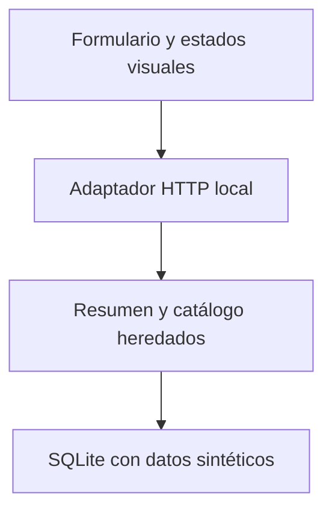

# Arquitectura mínima y trazabilidad

## Implementado

La aplicación tiene tres responsabilidades: presentar y enviar la selección,
adaptar HTTP a la función existente y aplicar las reglas del catálogo. Todos los
componentes se ejecutan en el equipo del lector. El navegador solicita los recursos
al mismo servidor local que recibe las consultas; no requiere una red de servicios.

| Componente | Responsabilidad | Contrato observado |
| --- | --- | --- |
| `web/index.html` | Controles etiquetados y zonas de resultado | Selección explícita, nombre opcional, total y códigos |
| `web/app.js` | Leer controles en cada envío y representar la respuesta | W05, W06.a, W06.b |
| `web/estilos.css` | Presentación adaptable y foco visible | Revisión visual separada de los criterios funcionales |
| `servidor.py` | Validar almacén requerido, adaptar HTTP, servir recursos permitidos | W01–W04 |
| `resumen.py` | Componer `almacen`, `total`, `codigos` y conservar la terminal | P01–P06 |
| `catalogo.py`, `detalle.py` | Filtrar por nombre y obtener código exacto | B01–B06, N01–N10 |
| `laboratorio.py`, SQL y datos | Preparar SQLite y aplicar disponibilidad local | C01–C04 |

El servidor se enlaza a `127.0.0.1`, una dirección de bucle local de uso didáctico.
No se especifica `0.0.0.0`. La ruta `/api/resumen` devuelve JSON y no expone los
archivos SQL. Las rutas estáticas son una lista explícita de cuatro rutas.
Las nuevas capas reutilizan los módulos del mismo estado; no importan archivos
de otros laboratorios ni dependen del historial de una conversación.

## Lo que una prueba de cada capa permite concluir

C, B, N y P verifican reglas, funciones y terminal. W01–W04 comprueban respuestas
HTTP reales. Estas últimas pasan incluso en la propuesta defectuosa: su servidor
es correcto. W05 interactúa con el formulario y detecta que la propuesta conserva
el almacén inicial. W06 comprueba los estados visibles de vacío y error.

Un servidor correcto no demuestra que el formulario le envíe la selección actual.
Una captura bonita tampoco demuestra ese recorrido. La evidencia del navegador
registra entradas y resultados del DOM después de cada interacción.

## Propuesto, no implementado

La evolución podría separar una base persistente de la preparación de datos,
añadir reglas de solicitudes y control de acceso, y definir observabilidad y
despliegue. Este paquete no contiene esas capacidades ni certifica sus decisiones.
Tampoco implementa un servidor apto para exposición pública. El diagrama representa
solo la aplicación local entregada.
